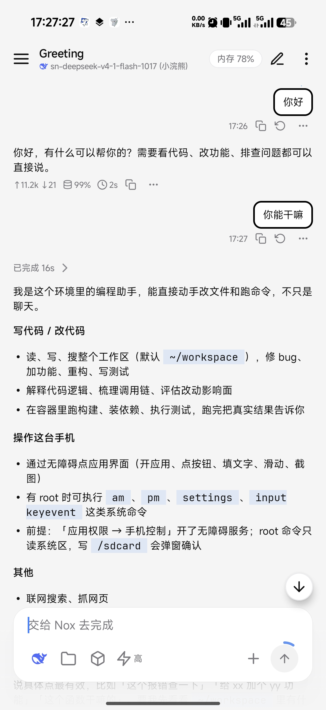
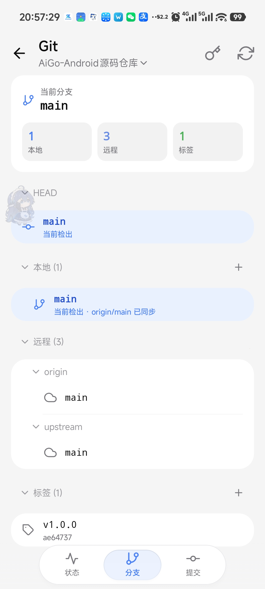
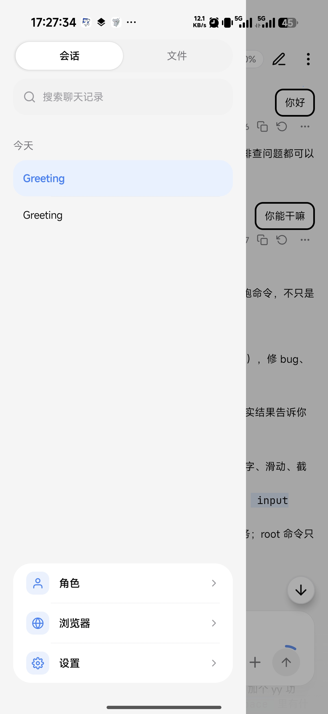
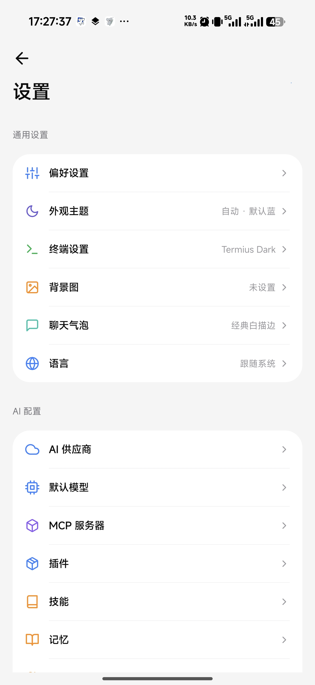
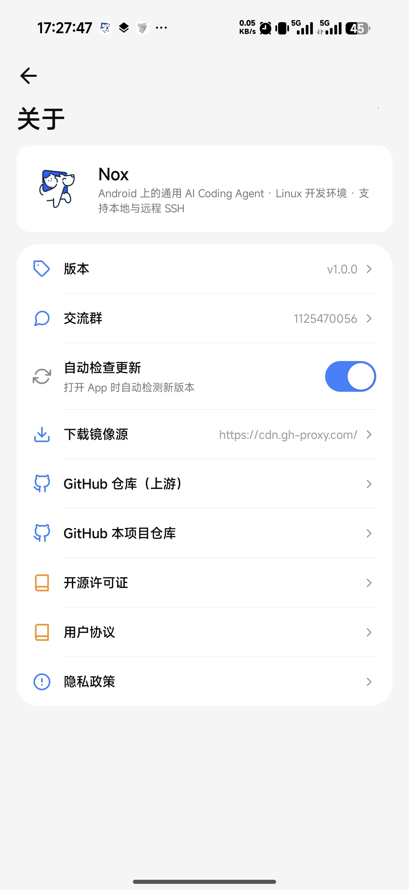

<p align="center">
  
  <h1 align="center">AiGo</h1>
  <p align="center">
    手机上的 AI 编程工具与移动工作站 · 基于 Nox（<a href="https://github.com/xzyy03/Nox">xzyy03/Nox</a>）二次开发
    <br />
    <a href="README.md">中文</a> · <a href="README.en.md">English</a>
  </p>
</p>

> [!IMPORTANT]
> **AiGo 是 Nox 的二次开发版（非官方），遵循 GPL-3.0 开源。**
>
> - **本项目**：[github.com/steveneng2020/AiGo](https://github.com/steveneng2020/AiGo)
> - **上游**：[xzyy03/Nox](https://github.com/xzyy03/Nox) → [jieapi/aicode](https://github.com/jieapi/aicode)
> - **许可证**：[GPL-3.0](LICENSE)（与上游一致，改动同样开源）
> - **包名**：`com.aigo`（与 Nox 的 `com.nox` 不同，可同机共存）
> - **联系邮箱**：steveneng@163.com

<p align="center">
  <a href="LICENSE"></a>
  
  <a href="https://github.com/steveneng2020/AiGo/releases"></a>
</p>

<p align="center">
  <table>
    <tr>
      <td align="center"></td>
      <td align="center"></td>
      <td align="center"></td>
      <td align="center"></td>
    </tr>
    <tr>
      <td align="center">新会话 · 选模型开聊</td>
      <td align="center">对话 · 工具调用</td>
      <td align="center">容器 · 多发行版</td>
      <td align="center">模型 · 任意供应商</td>
    </tr>
    <tr>
      <td align="center"></td>
      <td align="center"></td>
      <td align="center"></td>
      <td align="center"></td>
    </tr>
    <tr>
      <td align="center">Git · 状态与提交</td>
      <td align="center">侧栏 · 会话与入口</td>
      <td align="center">设置 · 偏好与配置</td>
      <td align="center">关于 · 版本与更新</td>
    </tr>
  </table>
</p>

---

## 简介

AiGo 是运行在 Android 上的通用 AI Coding Agent，把一套完整的 Linux 开发环境装进手机：内置终端，AI Agent 能读写文件、执行 Shell 命令、运行构建工具，写代码、调试到构建都在手机本地完成；也可改用远程 SSH 服务器作为执行后端，把手机变成远程项目的移动工作站。

上手只需装上 App、在「AI 供应商」配好模型即可直接开发；容器镜像首次使用需在设置里手动添加或下载。AiGo 不内置模型、不绑定供应商，支持 OpenAI / Anthropic / Gemini 三类协议与自定义供应商，模型、密钥与端点都由你自行配置。

## 与上游的关系

AiGo 源自 [Nox](https://github.com/xzyy03/Nox)，Nox 又源自 [AiCode](https://github.com/jieapi/aicode)。这条链上每一层都遵循 GPL-3.0，改动同样开源：

```
jieapi/aicode  ──▶  xzyy03/Nox  ──▶  steveneng2020/AiGo
  原始项目            直接上游              本项目
```

AiGo 与 Nox **可以同机共存**（包名不同，互不覆盖），装了两个也能各自使用。Nox 后续的更新会持续合入 AiGo。

## AiGo 做了什么

### 核心能力

以下为 AiGo 相对上游**长期累积的能力主张**，不随版本数量膨胀；具体每版改了什么见下方【近期更新】或 [CHANGELOG.md](CHANGELOG.md)。

| 能力 | 说明 |
| --- | --- |
| **手机控制不掉线** | 无障碍服务被系统或厂商 ROM 关掉时，按设备能力分三层恢复：感知掉线（全设备）、Root 写回设置、LSPosed 系统层接管。不需要用户自己去设置里翻。 |
| **权限一屏自检** | 7 项权限状态集中在一页，每项写明「不授予会失去什么」，并用「需注意」标出「开关开着、实际不可用」的情况——无障碍最容易这样。 |
| **用量看得懂、算得回** | 完整面板 + 本轮明细卡；累计与单次分开标注，缓存命中精确到两位小数，统计口径统一到同一份数据，相加能对上。 |
| **防误触可调** | 聊天页菜单一键开启，遮罩期间连侧边抽屉手势一并禁用；解锁时长 0.1~5 秒任选，精度如实显示。 |
| **界面可定制** | 九套图标（六套鲲 + 三套原图标），关于页点图标即换，桌面与通知栏同步；抽屉层级与插件分组可自选。 |
| **更新日记随包自带** | 断网也能看每个版本改了什么；与 GitHub Release 页同源，两处内容一致。 |

### 与 Nox 的区别

**配置差异**（是否可同机、指向哪个仓库这类）：

| 项 | Nox | AiGo |
| --- | --- | --- |
| 应用名 | Nox | AiGo |
| 包名 | `com.nox` | `com.aigo`（可同机共存） |
| 更新检查 | 指向 Nox 仓库 | 指向本项目 |
| 联系渠道 | QQ 群 | 邮箱 steveneng@163.com |

**能力差异**（AiGo 在上游基础上额外做的）：

| 项 | Nox | AiGo |
| --- | --- | --- |
| 权限自检 | 无 | 7 项一屏，每项标明缺失影响，三档状态 |
| 无障碍掉线 | 只能手动重开 | 三层自动恢复（感知 / Root / LSPosed） |
| 用量面板 | 回复底部一行小字 | 完整面板 + 本轮明细卡，口径统一 |
| 图标 | 一套 | 九套可选（六套鲲 + 三套原图标） |
| 防误触 | 基础遮罩 | 时长可调 0.1~5 秒，遮罩期间禁用抽屉手势 |
| 工程门禁 | 基础 | 产物级校验（包内日记 / 版本号 / 签名），pre-commit 18 项 |

上表为手工维护。英文版只保留概述与链接。

### 近期更新

> 本节由 `scripts/gen-readme-highlights.py` 从 [CHANGELOG.md](CHANGELOG.md) 自动生成，
> 只列**最近 2 个版本**的完整条目。更早的版本见 CHANGELOG；
> 「这个项目长期做了什么」看上面的【核心能力】，那部分不随版本膨胀。不要手改。

<!-- 新增与改进:START -->

**v1.0.6（2026-11-28）**

_新增_

- **权限健康页** — 入口在「设置 → 权限与后台 → 权限健康」，一屏列出后台运行、悬浮窗、存储访问、通知、无障碍服务、修改系统设置、安装应用这 7 项。每项写明「不授予会失去什么」，分「已就绪 / 需注意 / 缺失」三档。点任意一项跳到系统对应页；存储访问已授权时直接提示撤销路径——旧版会停在应用信息首页，权限列表还要自己往下翻，等于…
- **无障碍自动恢复** — 指「设置 → 权限与后台」里的「无障碍服务」与「自动保持无障碍」两项。手机控制依赖无障碍服务，而它常被系统或厂商 ROM 悄悄关掉，以前只能自己去设置里翻。现在按设备能力分三层：所有设备能立刻感知掉线并把状态标红；有 Root 的会自动写回设置（只补回本应用，不动你开着的其他无障碍服务）；装了 LSPosed 模块的…

_改进_

- **上下文用量图标缩小** — 入口在输入框左侧那排图标里（鲲 / 文件夹 / 立方体之后）。它带整块蓝色实心底，与旁边无底色的线性图标摆在一起显得偏大，像个高一层的控件。现将外框从 34 缩到 25、内部波形从 19 缩到 14、圆角从 9 缩到 7，渐变蓝底与白色波形样式不变，左侧与模型档位文字的间距也不动。

_优化_

- **聊天等待时显示已等时长** — 指发消息后等 AI 回复的那段。以前只有「正在思考」一直转，分不清是在正常生成还是卡住了。现在超过 3 秒在「正在思考」旁标出已等几秒，7 秒以上标「正常范围」，15 秒以上改「服务端较慢」。分档依据是实测 8511 次调用：首 token 延迟中位 6.3 秒、九成在 14.9 秒内。

_修复_

- **防误触模式的两处问题** — 入口在聊天页右上角「更多操作 → 防误触」，开启后全屏黑底、只留中央锁按钮，用来把手机放兜里或递给别人时防止误操作。两处修复：一是解锁时长按 0.1 秒精度显示——旧版设 0.7 秒却写「长按 1 秒退出」，按住时的倒计时也按整秒算，现在视觉提示、倒计时、读屏语音三处统一；二是遮罩期间左右抽屉不再能滑出，旧版遮罩只拦…

_上游同步_

- **b37dd2a · 会话上下文重置** — 给插件用的接口。某些上游按请求携带的轮数计数，到 100 轮就返回 `session_turn_limit_exceeded`，且不支持续接。插件现在可调 `chat.resetSessionContext` 把上下文起点移到当前时刻，之后只把该时刻后的消息发给模型，界面与数据库里的记录完整保留。
- **b37dd2a · 会话列表分组折叠** — 聊天页侧边会话列表按「今天 / 昨天 / 7 天内 / 30 天内」分组，点分组标题即可收起，标题右侧显示该组会话数与折叠箭头；置顶组不折叠——那是你主动钉住的，收起只会增加找它的成本。
- **b37dd2a · Fast 标记** — 快速模式生效时，闪电图标、档位与 Fast 文字一起变主色。
- **5c1a494 · 消息导航器** — 聊天页长按右下角导航按钮展开历史定位条，长对话里直接跳到某条消息。

**v1.0.5（2026-11-27）**

_修复_

- **用量面板区分「累计」与「单次」** — 入口在每条 AI 回复气泡下方的统计行，点开可看完整面板。面板上改成「缓存命中（累计）」，写明这是整场会话的加权结果——以前和压缩单次命中率并排时（累计 99.93% 与单次 0.23%），看着像自相矛盾，其实是两个范围。「上次压缩（单次）」只讲最近那一次，「压缩产出合计（共 N 次）」讲全部，两个数不再混在一起让人…
- **气泡右侧统计不再消失** — 同一行里的「首 token」与「输出速度」以前时不时不显示，而展开明细又能看到。原因是这半行要等另一张表写库，比左边那半行慢一拍，于是先显示一半、过几秒才补上，同一轮里前后还会算出不同的数。现在两边一起落库，回复结束就同时出现，不用等也不用刷新。

_上游同步_

- **396a627 · 插件整屏接管** — 插件可用 JSON DSL 整屏接管聊天页、设置页与侧边栏，支持 17 种节点、语义色与十六进制色、阴影与显式宽高，以及跳转 / 关闭 / 打开链接三种动作。
- **396a627 · 界面样式令牌** — 插件可改既有界面外观——输入框圆角与底色、气泡配色、顶栏、侧栏、图标色、正文文字色；多个插件按字段合并，各管一块可同时生效。

更早的 5 个版本（v1.0.4 ~ v1.0.0）见 [CHANGELOG.md](CHANGELOG.md)，App 内「关于 → 更新内容」也能离线查看。

<!-- 新增与改进:END -->

## 功能特性

### AI Agent

- **AI Agent** — 内置文件读写与编辑、Shell 执行、后台终端、代码与网页搜索、图片识别、待办清单等工具；流式输出并实时渲染 Markdown，长对话自动压缩上下文
- **内置浏览器** — 内置多标签 WebView 浏览器，AI 可导航、点击、填表与截图，直接在网页上完成操作；支持夜间模式与本地文件预览
- **子代理并行** — 主会话可派生独立上下文的子代理在后台并行调研、审查或对比方案，不阻塞当前对话；内置只读的 Explore 子代理，也可自定义模型、工具集与提示词
- **检查点与撤销** — Agent 改代码前自动记录文件快照，对话中可一键回滚代码、对话或两者
- **技能与自动记忆** — 支持全局/项目级技能（Skills）与长期记忆，AI 可跨会话复用经验与项目约定
- **MCP 协议** — 支持连接本地（stdio）与远程（HTTP）MCP 服务器，动态扩展 AI 工具能力
- **工具授权与自定义提示词** — 逐工具配置授权规则，系统提示词支持用户覆盖且 App 升级不丢失

### 模型与供应商

- **模型无关** — 不内置模型、不绑定供应商，模型、密钥与端点自行配置
- **协议兼容** — 兼容 OpenAI / Anthropic / Gemini 三类协议，内置多家官方预设，也支持自定义供应商，模型列表与单价可自定义
- **多 Key 轮换** — 同一供应商可配多个 Key，按顺序或轮询自动轮换，思考强度可调

### 开发环境

- **内置终端与容器** — 基于 Termux 与 PRoot 的本地 Linux 容器，内置 Alpine 镜像，支持导入自定义 rootfs、挂载宿主目录；终端多标签、可后台常驻
- **远程 SSH 模式** — 把远程服务器作为执行后端，命令、文件与终端都作用于远端项目
- **Shizuku 执行后端** — 借助 Shizuku，AI 可在宿主 Android 系统上执行 shell 与 adb 命令，用于调试或操作其他设备（需逐次授权确认）
- **文件树与代码编辑器** — 缩进式文件树点开即进全屏编辑器，支持主流语言语法高亮与 Markdown 预览；AI 回复里的 `文件:行号` 链接可直接跳转到对应行
- **Git 集成** — 看 AI 改了哪些文件、提交一次留个还原点、切分支、推送到远程。状态、差异、历史、标签都能可视化查看，AI 改乱了直接退回上一个提交
- **工作区同步** — 支持 SFTP / FTP 同步，内置 FTP 服务端方便电脑端管理文件

### 使用体验

- **平板与大屏适配** — 按窗口宽度自适应：宽屏常驻侧边栏，聊天旁并排显示代码或终端；变窄时退回单栏
- **Token 统计** — 按渠道与模型统计用量、估算费用，可下钻查看调用明细
- **外观与语言** — 主题明暗、预设配色、自定义背景图、多套应用图标，中英双语界面
- **网络代理** — 支持全局代理与供应商级代理分别配置
- **备份与还原** — 加密导出/导入供应商配置、凭据、聊天历史与工作区文件

## 快速开始

| 项目 | 说明 |
| --- | --- |
| 系统要求 | Android 8.0+（API 26），arm64-v8a / x86_64 |
| 下载地址 | [GitHub Releases](https://github.com/steveneng2020/AiGo/releases/latest)：真机选 `arm64` 包，模拟器选 `x86_64` 包，不确定选 `universal` |
| 快速上手 | 「设置 → AI 供应商」配模型 →「容器与镜像」选本地或 SSH → 新建会话开始对话 |
| 更新记录 | [Releases](https://github.com/steveneng2020/AiGo/releases)，App 内「关于」页也可查看 |
| 使用文档 | [docs-site/docs](docs-site/docs)（与 App 内置文档同源） |

## 版本说明

正式版的版本号就是 tag 本身，如 `1.0.0`。自己从源码构建的版本会带 `+日期` 后缀（如 `1.0.0+20261121`），用来区分是哪一次构建；日期不参与新旧比较，不影响更新提示。

App 内「关于」页可以查看每个版本的更新内容，断网也能看——这些说明随安装包一起下载到本地。

## 反馈与贡献

- **联系邮箱**：steveneng@163.com
- **Bug 反馈**：到 [Issues](https://github.com/steveneng2020/AiGo/issues) 提交，附上复现步骤、设备型号与系统版本
- **功能建议**：欢迎先在 [Issues](https://github.com/steveneng2020/AiGo/issues) 讨论
- **贡献代码**：欢迎提交 [Pull Request](https://github.com/steveneng2020/AiGo/pulls)

## Star

如果 AiGo 对你有帮助，欢迎给个 [Star](https://github.com/steveneng2020/AiGo)。

## 致谢

本项目建立在以下项目之上：

- [jieapi/aicode](https://github.com/jieapi/aicode) — 原始项目
- [xzyy03/Nox](https://github.com/xzyy03/Nox) — AiGo 的直接上游
- [OpenCode](https://github.com/anomalyco/opencode) — 终端 AI 编码工具，核心灵感来源
- [Termux](https://github.com/termux/termux-app) — Android 终端模拟器，提供终端组件与 PRoot 方案
- [Kelivo](https://github.com/Chevey339/kelivo) — 跨平台 LLM 聊天客户端，AI 对话界面设计参考

## 免责声明

AiGo 按「现状」提供，仅供学习、研究与合法的软件开发用途。严禁将本软件用于任何违法或侵权用途，包括但不限于未经授权入侵、破解、逆向工程他人软件或系统，绕过技术保护措施，窃取或泄露他人数据，传播恶意代码等侵害他人合法权益的行为。

使用者应自行承担使用本软件的全部风险与责任；对于使用者因使用或无法使用本软件而产生的任何损失，以及其利用本软件实施的任何行为及后果，作者与贡献者均不承担任何责任。

若不同意上述声明，请立即停止使用并卸载本软件。

## 开源协议

本项目基于 [GPL-3.0](LICENSE) 协议开源。依据 GPL-3.0，修改版本同样以 GPL-3.0 发布，并保留原作者的版权声明（见 [NOTICE](NOTICE)）。
